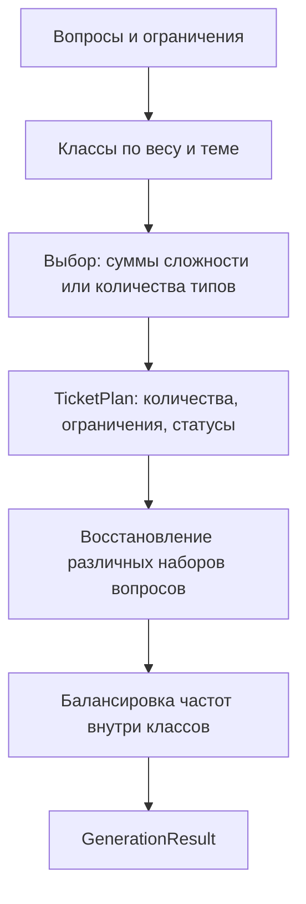
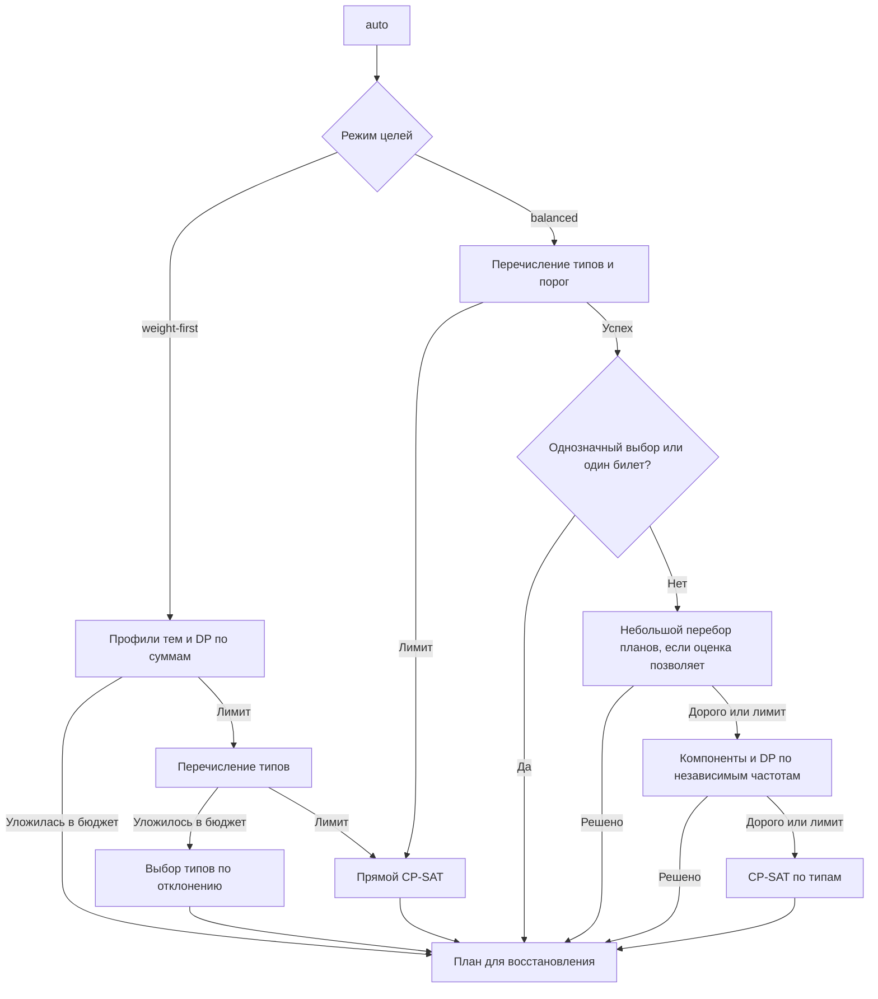

# Алгоритмы генерации билетов

Документ описывает текущий код: профили тем и DP по суммам, выбор количеств типов, точные сокращения, DP по частотам, CP-SAT и отдельное восстановление билетов. В конце описаны возможные дальнейшие улучшения. Команды и формат файлов — в [README.md](README.md).

## Обозначения

| Обозначение | Смысл | Мнемоника |
|---|---|---|
| $N$ | Общее число вопросов | Number |
| $T$ | Число непустых тем | Topics |
| $D$ | Число различных весов вопросов | Difficulty |
| $R$ | Число вопросов в результирующем билете | Result |
| $B$ | Число создаваемых билетов | Билеты |
| $n_i$ | Число вопросов темы $i$ | Размер темы |
| $d_i$ | Число различных весов в теме $i$ | Локальное $D$ |
| $C$ | Число классов взаимозаменяемых вопросов | Classes |
| $P_0$, $P$ | Число типов до и после отбора по отклонению | Patterns |
| $U$ | Сумма ограниченных вместимостей типов после отбора | Universe |
| $Q$ | Число выбираемых либо исключаемых экземпляров типов | Quantity |
| $\rho$ | Ранг координат «число билетов и частоты классов» в компоненте | Ранг |
| $M$ | Число состояний слоя DP по частотам | Memory states |
| $H$ | Число различных профилей тем | Histograms |
| $S$ | Максимальное число достижимых сумм на слое для одного количества вопросов; параметр DP по суммам | Sums |

Все параметры переменные. Для непустых тем:

$$
N=\sum_{i=1}^{T}n_i,\qquad d_i\le\min(D,n_i),\qquad H\le T\le N.
$$

Малое $D$ не означает малых весов или малого количества их сумм. Во всех оценках ниже арифметическая операция считается отдельно от её битовой стоимости. Код использует целые произвольной длины и `Fraction`; большие числители и знаменатели увеличивают время и память.

## Задача и текущая целевая функция

Билет $b$ — множество из $R$ вопросов. Требуется выбрать $B$ различных таких множеств. Один вопрос может входить в несколько билетов; порядок вопросов не учитывается.

| Режим | Ограничение |
|---|---|
| `different` | В билете не больше одного вопроса каждой темы; необходимо $R\le T$ |
| `same` | Весь билет принадлежит одной теме |
| `ignore` | Тематических ограничений нет |

Пусть $w_j$ — вес вопроса $j$, $W$ — целевой вес билета, $f_j$ — число появлений вопроса во всей выдаче. Обозначим:

$$
\delta_b=\left|\sum_{j\in b}w_j-W\right|.
$$

По умолчанию (`weight-first`) код лексикографически минимизирует:

$$
\left(\max_b\delta_b,\quad\sum_b\delta_b\right).
$$

Частоты затем выравниваются внутри взаимозаменяемых классов. Между разными классами нет обязательного равенства и нет обещания глобального частотного оптимума. Это позволяет редким сложным вопросам встречаться редко.

Режим совместимости `balanced` сохраняет прежнюю строгую задачу:

$$
\left(\max_b\delta_b,\quad\sum_{j=1}^{N}f_j^2,\quad\sum_b\delta_b\right).
$$

В `balanced` частоты важнее суммарного отклонения, но менее важны, чем максимальное отклонение. Режимы решают разные задачи; сравнивать их результаты как два решателя одного критерия нельзя.

## Архитектура: выбор и восстановление

`src.planning.plan_tickets()` выбирает план. `src.reconstruction.restore_tickets()` восстанавливает вопросы, не вызывая оптимизатор. `src.generation.generate_tickets_report()` объединяет этапы.

У DP по суммам план содержит количества выбранных сумм и таблицы продолжений, у других методов — количества типов. Восстановление сохраняет строгие критерии выбранного режима. В `balanced` частотный штраф вычисляется до восстановления и достигается заменами внутри классов. Прямая модель CP-SAT также отдаёт план общему восстановителю.

## Профили тем и DP по суммам

Это основной путь `auto` для `weight-first`, имя в результате — `profile-sum-dp`.

### Сжатие профилей

Профиль темы — отсортированная гистограмма «вес → число вопросов этого веса». Темы с одинаковыми гистограммами используют одну таблицу, но сохраняют отдельные наборы исходных классов. Для профиля $h$ хранятся кратность $m_h$ и отображение каждой исходной темы на её классы.

В `different` одинаковые темы — разные позиции в билете. Их произведение вычисляется двоичным возведением полинома в степень с переиспользованием таблиц одинаковых степеней. При восстановлении левый и правый блоки получают непересекающиеся диапазоны исходных тем. Поэтому никакие два вопроса одной темы не появляются в билете из-за сжатия.

В `same` таблица сочетаний вычисляется один раз на профиль, а число способов умножается на $m_h$. Восстановление сначала выбирает исходную тему, затем её вопросы. В `ignore` темы не участвуют в ограничениях: используется одна гистограмма всех вопросов по весам.

### Состояния и переходы

Коэффициент $F(k,s)$ — число различных допустимых наборов из $k$ вопросов с суммой весов $s$. Все количества точные, без обрезки числом $B$: они нужны для восстановления по комбинаторным индексам.

Для одной темы в `different`, если вес $w$ встречается $h_w$ раз:

$$
F(0,0)=1,\qquad F(1,w)=h_w.
$$

При $R=T$ пропуск темы запрещён, и коэффициент $F(0,0)$ не добавляется. В блоке тем число взятых вопросов тогда однозначно определяется числом тем блока.

В `same` и `ignore` один класс веса $w$ из $h_w$ вопросов даёт:

$$
F(a,aw)=\binom{h_w}{a},\qquad 0\le a\le\min(R,h_w).
$$

Слои по классам объединяются ограниченным рюкзаком с подсчётом способов. Для независимых блоков вопросов используется свёртка:

$$
(F\ast G)(k,s)=\sum_{a+b=k}\sum_{u+v=s}F(a,u)G(b,v),\qquad k\le R.
$$

В `different` свёртка объединяет темы; повторяющиеся темы используют степени одного и того же полинома. В `same` результаты разных исходных тем складываются, а не перемножаются.

### Выбор оптимальной сложности

В корневой таблице $F(R,s)$ — вместимость суммы $s$. Суммы упорядочиваются по $|s-W|$, после чего выбираются первые $B$ билетов с учётом этих вместимостей. Это одновременно минимизирует максимальное и суммарное отклонения: никакой выбранный билет нельзя заменить невыбранным с меньшим отклонением.

На последнем уровне равного отклонения количество распределяется пропорционально вместимостям с округлением методом наибольших остатков. Это эвристика разнообразия при равном качестве, не новый строгий критерий.

План содержит только количества сумм. При восстановлении для каждой суммы выбирается по одному индексу из непересекающихся равных интервалов её пространства вариантов. Фиксированный seed обеспечивает воспроизводимость. Выбор разных индексов гарантирует различные исходные комбинации, а таблицы продолжений позволяют разобрать индекс без перечисления всего пула.

Пустые поддеревья при разборе сразу пропускаются. Для сбалансированного дерева `different` посещаются пути выбранных тем — $O(R\log T)$ узлов, а не все $T$ тем; просмотр состояний внутри узлов оплачивается дополнительно.

Индексы разбираются до количеств исходных классов; затем общий восстановитель строит нужное число различных билетов каждого типа и балансирует его вопросы. Количество выбранных экземпляров типа не превышает его вместимость, поскольку получено из различных комбинаторных индексов.

### Фактическая асимптотика

Текущая реализация использует разреженные свёртки. Для произведения узлов с $L_1$ и $L_2$ состояниями она проверяет $L_1L_2$ пар. Если $E$ — набор вычисленных произведений, время свёрток:

$$
O\left(\sum_{e\in E}L_{e,1}L_{e,2}\right).
$$

В `different` число узлов произведения — $O(H+\sum_h\log m_h)$. При $R=T$ каждый блок имеет одно возможное количество вопросов, поэтому $L\le S$; в общем случае $L\le(R+1)S$. Повторное использование степеней сокращает число таблиц, но не делает сами свёртки бесплатными.

Для слоёв сочетаний в `same` и `ignore` стоимость переходов пропорциональна сумме по состояниям числа допустимых количеств следующего веса. Грубая оценка на профиль с $d_h$ весами — $O(d_hR^2S)$, без битовой стоимости биномиальных коэффициентов.

Сохраняются таблицы, нужные восстановлению: память пропорциональна сумме их размеров, а не только последнему слою. `--max-dp-states` ограничивает именно эту сумму; бюджет проверенных переходов — в 10 раз больше. Восстановление оплачивается отдельно: разбор одного индекса просматривает ветви таблиц, но не весь набор конкретных билетов.

Оценка $O(TRDS)$ относится к альтернативной последовательной обработке тем с маленькими переходами. Она не является оценкой реализованной свёртки двух больших блоков. Последовательные переходы могут быть выгоднее на некоторых банках; сейчас слишком дорогая свёртка останавливается по бюджету, и `auto` переходит к типам или CP-SAT.

## Выбор по типам как резервный путь

При `weight-first` достаточно перечислить типы и брать их в порядке отклонения с учётом вместимостей: метод `weight-types`. На равных отклонениях количества распределяются пропорционально ограниченным вместимостям. В этой задаче глобальная DP по частотам не обязательна.

В `balanced` нужны следующие точные сокращения и решатели. Принудительные `enumerate` и `dp` поддерживают также `weight-first`: сначала минимизируют суммарное отклонение, а частотный штраф используют для разрешения равенства. Общая публичная гарантия этого режима остаётся двумя строгими критериями и балансировкой внутри классов.

## Классы и типы билетов

В `ignore` вопросы объединяются по весу, поэтому $C=D$. В `same` и `different` класс задаётся парой «тема, вес»:

$$
C=\sum_{i=1}^{T}d_i\le\min(N,TD).
$$

Пусть в классе $c$ находится $s_c$ вопросов с весом $w_c$. Тип билета $p$ — вектор количеств $a_{cp}$:

$$
\sum_{c=1}^{C}a_{cp}=R,\qquad 0\le a_{cp}\le s_c.
$$

Дополнительно соблюдаются ограничения режима. Например, в `different` сумма $a_{cp}$ по классам одной темы не превосходит 1.

Количество различных конкретных билетов типа и используемая кодом вместимость:

$$
\operatorname{cap}_p=\prod_{c=1}^{C}\binom{s_c}{a_{cp}},\qquad
u_p=\min(B,\operatorname{cap}_p).
$$

Обрезка вместимости числом $B$ безопасна: больше $B$ экземпляров одного типа не нужно ни в одном решении. Конкретные билеты разных типов не совпадают, поэтому вместимости складываются.

### Сколько бывает типов

До отбора по отклонению:

| Режим | Оценка $P_0$ |
|---|---|
| `ignore` | $P_0\le\binom{R+D-1}{D-1}$ |
| `same` | $P_0\le\sum_{i=1}^{T}\binom{R+d_i-1}{d_i-1}$ |
| `different` | $P_0=\displaystyle\sum_{\substack{I\subseteq\{1,\ldots,T\}\\ \lvert I\rvert=R}}\prod_{i\in I}d_i\le\binom{T}{R}D^R$ |

Первые две оценки игнорируют ограничения размеров классов и могут быть завышены. В `same` темы с $n_i<R$ вообще не дают билетов. В `different` выбор темы и доступного в ней веса уже задаёт допустимый тип, поэтому приведённое выражение через $d_i$ точное.

`ticket_types.enumerate_types()` использует стек частичных составов и не перебирает подмножества исходных вопросов. Число посещённых и ожидающих обработки состояний ограничивается `--max-search-nodes`. Время перечисления зависит и от промежуточных составов, поэтому оценивать его только как $O(P_0)$ нельзя. Готовые типы сортируются за $O(P_0\log P_0)$ сравнений; сравнения рациональных отклонений и составов имеют дополнительную стоимость.

## Точный минимакс через порог

Отклонение типа:

$$
\delta_p=\left|\sum_c a_{cp}w_c-W\right|.
$$

Минимальный допустимый порог:

$$
\Delta^*=\min\left\{\Delta:\sum_{p:\delta_p\le\Delta}u_p\ge B\right\}.
$$

При меньшем пороге различных билетов не хватает. При найденном пороге можно выбрать $B$ билетов, поскольку наборы разных типов не пересекаются. Это доказывает оптимальность первого критерия без CP-SAT.

Дальше остаются все $P$ типов с $\delta_p\le\Delta^*$. Если общей вместимости недостаточно даже без порога, задача несовместна.

## Частоты без подстановки вопросов

Для выбранных количеств $x_p$:

$$
0\le x_p\le u_p,\qquad\sum_p x_p=B,\qquad A_c=\sum_p a_{cp}x_p.
$$

$A_c$ — общее число появлений вопросов класса $c$. Для класса размера $s$, если $A=qs+t$ и $0\le t<s$, минимальная сумма квадратов частот равна:

$$
F_s(A)=(s-t)q^2+t(q+1)^2.
$$

В `balanced` оставшаяся задача по типам:

$$
\min_{x}\left(\sum_c F_{s_c}(A_c),\quad\sum_p\delta_p x_p\right).
$$

Этот штраф достижим одновременно во всех классах при сохранении типов и уникальности. Доказательство через замены приведено в разделе восстановления. Поэтому модель по типам сохраняет все три критерия, а не только сложность билетов.

## Точные сокращения перед перебором и DP

### Дополнение

Пусть $U=\sum_pu_p\ge B$. Вместо включаемых экземпляров можно выбирать исключаемые:

$$
Q=\min(B,U-B).
$$

При $U-B<B$ вводится $y_p=u_p-x_p$. Тогда:

$$
\sum_p y_p=Q,\qquad
A_c=\sum_p a_{cp}u_p-\sum_p a_{cp}y_p.
$$

Суммарное отклонение — константа минус $\sum_p\delta_p y_p$, поэтому линейные стоимости меняют знак. Частотный штраф считается по восстановленным $A_c$, а не по частотам исключённых вопросов.

Здесь $U$ относится к ограниченным вместимостям $u_p$. Это дополнение в пространстве количественных планов; не требуется перечислять все конкретные билеты пула.

### Независимые компоненты

Два класса соединяются, если встречаются в одном типе. Компоненты этого вспомогательного графа независимы по частотному штрафу и линейной стоимости. Между ними остаётся распределить общее количество $Q$.

В `same` разные темы всегда находятся в разных компонентах; внутри темы возможно дополнительное разбиение. Компоненты вычисляются объединением множеств в `reduction.components()`.

### Независимые координаты частот

Для одной компоненты рассматривается матрица: первая строка содержит единицы, остальные — коэффициенты $a_{cp}$. Первая координата состояния — число выбранных экземпляров, остальные — независимые частоты.

Точный метод исключения над рациональными числами выбирает базис строк. Зависимые частоты затем восстанавливаются по базисным координатам. Поскольку сумма всех частот равна $R$ умножить на число экземпляров:

$$
\rho\le\min(C,P).
$$

Здесь $C$ и $P$ относятся к рассматриваемой компоненте. При `different` и $R=T$ каждая тема даёт собственное равенство «число появлений равно числу билетов», поэтому для всей матрицы:

$$
\rho\le C-T+1.
$$

В коде независимые частоты с меньшими диапазонами рассматриваются раньше. Построение базиса тоже требует ресурсов: грубая арифметическая оценка — $O(C\rho(P+\rho))$, без учёта роста разрядности. На этот этап установлен отдельный бюджет работы, связанный с `--max-dp-states`.

## Перебор количественных планов

`enumeration_selection.py` перебирает количества типов после перехода к дополнению, если он выгоден. Ветка отсекается, если остатка вместимостей недостаточно для нужного количества. На полном плане сравниваются частотный штраф и суммарное отклонение.

Если $L$ — число допустимых планов, а $v_p=\min(u_p,Q)$, то:

$$
L\le\min\left(\prod_{p=1}^{P}(v_p+1),\quad\binom{Q+P-1}{P-1}\right).
$$

Оценка нужна для выбора метода; это не число конкретных наборов билетов. Одинаковый план может восстанавливаться многими способами.

Глубина дерева не превосходит $P$. С учётом копирования векторов частот и путей грубая оценка времени реализации — $O((1+PL)(C+P+R))$ арифметических операций. Реальный поиск ограничен `--max-search-nodes` и может завершиться раньше с ошибкой лимита или переключением метода в `auto`.

## DP по независимым частотам

Для одной компоненты состояние имеет вид:

$$
(z,f_{c_1},\ldots,f_{c_{\rho-1}}),\qquad 0\le z\le Q.
$$

В нём хранится минимальная линейная стоимость и ссылка на предыдущий шаг. При одинаковых координатах все частоты, а значит и частотный штраф, совпадают: достаточно сохранить вариант с меньшей линейной стоимостью.

Грубая граница числа состояний слоя:

$$
M\le(Q+1)(RQ+1)^{\rho-1}.
$$

Код использует более узкие границы для каждой частоты и хранит только достижимые состояния. Количество экземпляров типа раскладывается на двоичные пакеты: $1,2,4,\ldots$ и остаток. На тип требуется $O(\log(v_p+1))$ пакетов, каждый обрабатывается как предмет 0–1-рюкзака.

Для одной компоненты переходы занимают:

$$
O\left(M\rho\sum_{p=1}^{P}\log(v_p+1)\right)
\subseteq O\left(PM\rho\log(Q+1)\right),\qquad Q\ge1.
$$

Дополнительно нужны построение проекции и оценка конечных состояний — до $O(MC\rho)$ арифметических операций. При $Q=0$ выбирается весь пул без динамики выбора.

Для $J$ компонент вычисляются локальные оптимумы по числу экземпляров, затем объединяются рюкзаком. Грубая дополнительная оценка объединения — $O(JQ^2)$ переходов. Локальные параметры $M$, $\rho$, $C$, $P$ могут сильно различаться.

Ключи и значения одного слоя занимают $O(M\rho)$ машинных объектов без учёта разрядности. Ссылки на пути могут удерживать узлы предыдущих слоёв: полная память не ограничивается одним слоем. Число созданных узлов пути ограничено числом успешных обновлений, а число переходов — установленным бюджетом. Код не копирует весь путь при каждом переходе.

### Как влияют режимы

| Режим | Что сокращается |
|---|---|
| `ignore` | $C=D$, поэтому $\rho\le D$ |
| `same` | В каждой компоненте $C\le d_i\le D$; компоненты объединяются по количеству билетов |
| `different` | $C$ может достигать $TD$; дополнительные зависимости помогают, особенно при $R=T$, но малого $D$ недостаточно |

При фиксированном $D$ оценки этой DP для `ignore` и локальных компонент `same` полиномиальны по числовым размерам $R,B$. Это свойство оценки, а не предположение, что $D$ постоянно: в общем случае степень растёт вместе с ним. Размер явного результата составляет $BR$ вхождений вопросов.

## CP-SAT

### Модель по типам

`cp_selection.select_types()` создаёт целочисленные количества $x_p$, ограничения вместимостей и суммы $B$. Частотный штраф задаётся точным выпуклым кусочно-линейным представлением $F_s$ на целых аргументах.

Минимакс уже доказан порогом. В `balanced` две стадии CP-SAT последовательно минимизируют частотный штраф и суммарное отклонение, фиксируя доказанный оптимум предыдущей стадии. В `weight-first` остаётся одна стадия — суммарное отклонение; переменные и ограничения частотного штрафа не строятся.

Грубый размер пространства количественных назначений:

$$
\prod_{p=1}^{P}(u_p+1)\le(B+1)^P.
$$

Это размер наивного пространства, **не оценка времени CP-SAT**. Решатель использует распространение ограничений и отсечения; общей полиномиальной гарантии для произвольных входов нет. Сокращение числа переменных может существенно помочь, но не даёт само по себе гарантированного ускорения каждого запуска.

### Прямая модель

Если перечисление типов превышает бюджет или явно выбран `--algorithm cp-sat`, создаются $NB$ основных булевых переменных «вопрос входит в билет». Добавляются размер билета, условия групп, частоты, отклонения и строгий лексикографический порядок строк билетов. Порядок одновременно исключает дубли и симметрию перестановки билетов.

Здесь решатель последовательно доказывает два критерия `weight-first` либо три критерия `balanced`. Весовые коэффициенты масштабируются в целые без округления; слишком большие коэффициенты отклоняются проверками диапазона.

### Статусы

Все стадии одного вызова CP-SAT используют общий бюджет `--time-limit`. Это бюджет решения, а не всей генерации.

`proven_objectives` сообщает число последовательно доказанных критериев. `optimal=true` выставляется при доказательстве всех строгих критериев выбранного режима: двух или трёх. Это число записывается в `objective_count`; режим — в `objective_mode`. `frequency_guarantee=within-class` не означает глобального оптимума частот. В `balanced` значение `global-optimum` выставляется только после доказательства частотной стадии. С `--allow-feasible` можно получить допустимый результат с неполным доказательством; при отсутствии найденного решения выдаётся ошибка. Восстановление сохраняет статус доказанности плана и не доказывает оптимальность оставшихся критериев.

## Восстановление конкретных билетов

Для каждого типа лениво перебирается произведение сочетаний вопросов классов и берётся нужное число различных наборов. Затем частоты выравниваются заменами внутри классов.

Пусть вопросы $u,v$ принадлежат одному классу и $f_u>f_v+1$. Обозначим через $\mathcal A$ выбранные билеты с $u$ без $v$, а через $\mathcal B$ — с $v$ без $u$. Тогда:

$$
|\mathcal A|-|\mathcal B|=f_u-f_v>1.
$$

Если замена $u\to v$ в каждом билете из $\mathcal A$ уже присутствовала бы в выдаче, она задавала бы инъекцию $\mathcal A\to\mathcal B$, что невозможно. Значит, существует замена, сохраняющая уникальность. Она сохраняет тип, вес и тематические ограничения, а изменение штрафа равно:

$$
(f_u-1)^2+(f_v+1)^2-f_u^2-f_v^2=-2(f_u-f_v-1)<0.
$$

Остальные классы не меняются. Повторение замен приводит к разнице частот не более 1 внутри каждого класса и достигает $F_{s_c}(A_c)$ одновременно для всех классов.

В реализации используются стабильные индексы билетов, множества выбранных составов, списки появлений вопросов и две кучи на класс для минимальной и максимальной частоты. При замене обновляются появления только двух изменённых вопросов. Устаревшие записи куч удаляются лениво; периодическое перестроение ограничивает их размер.

### Цена восстановления

Сумма частот равна $RB$, каждая частота не превосходит $B$, поэтому:

$$
\sum_j f_j^2\le RB^2.
$$

Каждая замена уменьшает целочисленный штраф хотя бы на 2: замен не больше $O(RB^2)$. Поиск подходящего билета может просмотреть $B$ появлений, а создание и хеширование замены требует $O(R)$ ожидаемых операций. Грубая оценка балансировки:

$$
O\left(N+RB^2(BR+\log N)\right).
$$

Это заведомо широкая верхняя граница, не прогноз времени конкретного банка. Она не учитывает патологические коллизии хешей и разрядность чисел. Дополнительно выполняются первоначальное построение наборов, сортировка вопросов и билетов и запись результата; только вывод уже требует $\Omega(BR)$ операций без учёта длины текстов. Поэтому восстановление нельзя автоматически считать линейным по размеру выдачи.

## Фактический автовыбор

В `balanced` перебор автоматически выбирается, если оценка числа планов, умноженная на $P$, не превосходит `min(10000, max_search_nodes)`. Это порог бюджета, а не предположение о постоянных $T,D,R$. DP по частотам выбирается по оценке состояний; фактический рост также контролируется.

В `weight-first` новая DP по суммам пробуется в пределах её бюджета; сохранённые состояния и проверенные переходы возвращаются в `diagnostics`. Причины переключений тоже сохраняются. Это ограниченный поиск подходящего представления, а не обещание самого быстрого решателя для любого входа.

Специализаций для $R=1$ и $R=2$ нет. Алгоритмы потоков, паросочетаний и раскраски сейчас не вызываются.

## Возможные дальнейшие улучшения

Для `different` можно сравнивать стоимость последовательных переходов по темам и свёрток блоков. Сжатие одинаковых профилей уже работает; следующий шаг — выбирать способ умножения по размерам разреженных таблиц.

Локальные назначения через min-cost flow остаются возможной эвристикой частот. При $R=T$ можно фиксировать все темы, кроме одной, и перераспределять оставшуюся. Нужно сохранять качество по сложности и запрещать дубли; оптимальность одного блока не даёт глобальной оптимальности последовательности блоков. При $R<T$ нужны также изменения набора тем.

Сравнение $T<N^2$ практически бесполезно: уже $T\le N$. Для выбора представления полезнее $H$ относительно $T$, число сумм $S$, число типов $P$, ранг $\rho$ и размер дополнения $Q$.

Тесты отдельно проверяют новый порядок целей и прежний `balanced`, количества способов и комбинаторное восстановление, вместимости, лимиты и статусы доказанности. Команда запуска — в [README.md](README.md).
