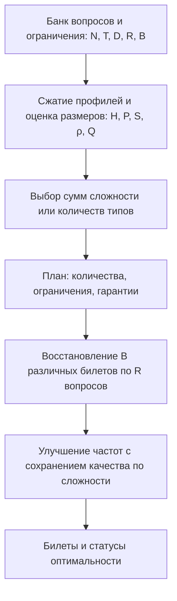
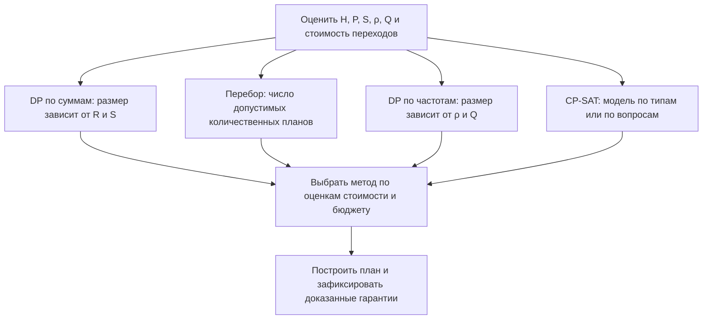

# Предложение по переработке генератора билетов

**Статус: исходный проект, основные изменения реализованы.** Новый режим целей `weight-first`, сжатие профилей тем, DP по суммам и независимое восстановление включены в программу. Текущие интерфейсы и гарантии описаны в [README.md](README.md) и [ALGORITHMS.md](ALGORITHMS.md). Ниже сохранено исходное обсуждение; локальные назначения через потоки пока остаются предложением.

Цель — использовать структуру конкретного банка: количество тем, различных сложностей, вопросов в билете, повторяющиеся профили тем и размер выдачи. Специальные алгоритмы только для одного или двух вопросов не возвращаем. Все параметры считаются переменными.

## 1. Обозначения

Используем короткие буквенные обозначения с мнемоникой. В частности, $R$ — размер результирующего билета, а число тем обозначаем $T$.

| Обозначение | Что означает | Мнемоника |
|---|---|---|
| $N$ | Общее число вопросов | Number |
| $T$ | Число тематических групп | Topics |
| $D$ | Число различных значений сложности | Difficulty |
| $R$ | Число вопросов в одном результирующем билете | Result |
| $B$ | Число билетов, которые нужно создать | Билеты |
| $n_i$ | Число вопросов в теме $i$, где $1 \le i \le T$ | Размер темы |
| $H$ | Число различных профилей тем | Histogram |
| $m_h$ | Число исходных тем с профилем `h` | Multiplicity |
| $P$ | Число рассматриваемых типов билетов | Patterns |
| $S$ | Максимальное число достижимых сумм для одного количества вопросов на одном слое DP | Sums |
| $\rho$ | Число независимых координат состояния DP по частотам, включая число выбранных билетов | Ранг, rho |
| $U$ | Суммарная вместимость рассматриваемого пула типов | Universe |
| $Q$ | Число включаемых либо исключаемых экземпляров типов, которыми оперирует поиск | Quantity |

Основные параметры задачи — $N$, $T$, $D$, $R$, $B$. Остальные описывают выбранное представление и помогают оценить стоимость алгоритма. Все параметры переменные; конкретные значения не зашиты в выбор метода.

Для непустых тем $N = \sum_{i=1}^{T} n_i$ и $H \le T \le N$. В `different` необходимо $R \le T$. Число $D$ обозначает количество разных весов, а не максимальный вес: малое $D$ не гарантирует малого $S$.

По сравнению с прежними обозначениями: число тем $K \to T$, размер билета $r \to R$. Ранг обозначаем $\rho$, чтобы не смешивать его с размером билета.

Это обозначения для документации и рассуждений. Переименовывать JSON-поля `weight` и `group` ради них не требуется.

## 2. Условия задачи

Сохраняем:

- ровно $R$ различных вопросов в каждом билете;
- ровно $B$ билетов;
- вопросы могут повторяться между билетами;
- одинаковые наборы вопросов в разных билетах запрещены;
- порядок вопросов не делает билет новым;
- заданный целевой суммарный вес билета.

Режимы групп:

| Режим | Условие |
|---|---|
| `different` | Все вопросы билета из разных тем |
| `same` | Все вопросы билета из одной темы |
| `ignore` | Темы не ограничивают состав |

В `different` при $R = T$ каждый билет содержит вопрос из каждой темы. При меньшем размере билета можно выбирать подмножество тем.

## 3. Предлагаемое изменение приоритетов

Сейчас глобальное выравнивание частот стоит выше суммарного отклонения сложности. Предлагаю поменять порядок и ослабить требование к частотам:

1. Минимизировать наибольшее отклонение сложности билета от целевого веса.
2. Минимизировать сумму отклонений сложности всех билетов.
3. Улучшать разнообразие и частоты без ухудшения первых двух критериев.

При этом **не требовать одинаковой частоты вопросов разных сложностей**. Редкие тяжёлые вопросы могут встречаться редко. Основное требование равномерности — справедливо распределять уже выбранные появления между взаимозаменяемыми вопросами.

Практически это означает:

- сложность и уникальность — строгие требования;
- балансировка внутри исходного класса «тема, сложность» выполняется при восстановлении;
- глобальная равномерность между разными классами — мягкая цель для локального улучшения;
- нет обязательства использовать каждый вопрос хотя бы один раз. Если оно понадобится, это отдельное ограничение и другая задача выбора.

**Это предложение об изменении критерия, а не просто ускорение прежнего алгоритма.** Оно позволяет сильнее сжимать задачу. Если потребуется сохранить доказанный глобальный оптимум частот, нужно оставить более подробную модель и точный решатель для этого критерия.

## 4. Общая архитектура



Выбор набора и восстановление остаются самостоятельными этапами. Между ними передаётся план с количествами выбранных типов либо сумм сложности, ограничениями и статусом оптимальности.

Представление плана зависит от выбранного решателя. Для восстановления по суммам потребуется также доступ к таблицам подсчёта допустимых продолжений либо возможность их повторно вычислить.

## 5. Первое сокращение: одинаковые профили тем

Профиль темы:

```text
{значение сложности → число вопросов такой сложности}
```

Темы с одинаковыми профилями и одинаковыми дополнительными ограничениями можно представить одним типом темы с кратностью.

Важно сохранять:

- сколько исходных тем входит в профиль;
- исходные вопросы и принадлежность к темам;
- вместимости разных составов;
- ограничения на использование исходных тем внутри билета.

В `different` из профиля с кратностью $m_h$ нельзя использовать больше $m_h$ разных исходных тем. Простое объединение всех вопросов профиля в одну общую тему было бы неправильным.

В `same` все вопросы билета должны восстанавливаться внутри одной исходной темы, даже если несколько тем имеют одинаковый профиль.

Сжатие сохраняет допустимость и количество вариантов для выбора по сложности. **Сохранение глобального оптимума частот между всеми исходными вопросами автоматически из этого не следует.** Поэтому предлагаемое ослабление критерия частот здесь существенно.

Полезное соотношение — $H$ относительно $T$. Но уменьшение числа описаний не означает автоматического уменьшения времени в том же отношении: кратности тоже нужно учитывать. Обработку повторяющихся профилей через степени переходов или последовательные копии выбираем по оценке стоимости.

## 6. Вариант выбора: DP по числу вопросов и сумме сложности

Для `different` последовательно обрабатываем темы. Состояние:

```text
(число взятых вопросов, сумма сложности)
    → количество различных допустимых билетов
```

При обработке темы можно:

- пропустить её;
- выбрать один вопрос некоторой сложности, умножив количество продолжений на число таких вопросов в теме.

Таким образом, ограничения тем соблюдаются в переходах, без отдельной координаты частоты для каждой темы.

Оценка числа переходов:

$$
O(T R D S)
$$

Память для подсчёта с двумя слоями:

$$
O(R S)
$$

Если $R = T$, пропусков нет, а число выбранных вопросов определяется номером слоя:

$$
\begin{aligned}
\text{Время подсчёта:}\quad & O(T D S) \\
\text{Память:}\quad & O(S)
\end{aligned}
$$

Это структурный случай, а не фиксация размера билета конкретным числом.

### Где находится ограничение этой DP

$S$ также является переменной. При некоторых наборах весов число разных сумм велико. Для целых нормализованных весов можно оценивать диапазон сумм; для произвольных точных весов — хранить только достижимые суммы в разреженной таблице.

Нельзя считать этот алгоритм безусловно быстрым только потому, что $D$ невелико. Плотная DP по диапазону целых весов имеет псевдополиномиальную зависимость от их величины.

### Как получать билеты

По количеству вариантов каждой суммы выбираются лучшие суммы сложности с учётом нужного числа билетов. Затем различные конкретные билеты восстанавливаются по разным комбинаторным индексам, используя количества допустимых продолжений.

Для этого нужно либо хранить таблицы нескольких слоёв, либо пересчитывать их. Сохранение всех слоёв увеличивает память подсчёта в общем случае ещё в $T$ раз. Расходы восстановления учитываются отдельно, а не скрываются в оценке подсчёта.

Этот путь может точно оптимизировать первые два критерия и обеспечить уникальность. Глобальная балансировка частот остаётся отдельной задачей.

## 7. Вариант выбора: типы билетов и независимые частоты

Если необходимо сохранять подробный контроль за использованием классов, остаётся модель по типам билетов.

Тип описывает количества вопросов каждого класса. Его вместимость ограничивает число различных конкретных билетов этого типа.

Перед решением:

1. Удаляем типы, не проходящие оптимальный порог отклонения сложности.
2. Удаляем классы, не участвующие в оставшихся типах.
3. Разделяем независимые компоненты.
4. Исключаем линейно зависимые частоты.
5. Проверяем, не проще ли выбирать исключения из допустимого набора.

Например, при `different` и $R = T$ сумма появлений вопросов каждой темы равна числу выбранных билетов. Это даёт несколько зависимостей между частотами, а не только одну зависимость от общего числа мест.

Пусть $U$ — сумма вместимостей оставшихся типов и $U \ge B$. Для выбора включаемых либо исключаемых экземпляров типов:

$$
Q = \min(B, U - B)
$$

При выборе исключений стоимости и итоговые частоты пересчитываются соответствующим образом; нельзя просто применить прежнюю целевую функцию к исключённым вопросам.

Грубая оценка числа состояний DP после исключения зависимых частот:

$$
(Q + 1)(R Q + 1)^{\rho - 1}
$$

$\rho$ — ранг системы координат: число выбранных экземпляров и независимые частоты классов. Координата числа выбранных экземпляров учитывается в $\rho$. В конкретной задаче границы каждой координаты можно оценить точнее.

Количество экземпляров типа можно обрабатывать двоичными пакетами вместо перебора всех количеств на каждом переходе. Пути восстановления DP следует хранить ссылками, а не копировать целиком при каждом обновлении.

## 8. Эвристическое улучшение через назначения и потоки

Для `different`, когда каждый билет содержит все темы:

1. Фиксируем вопросы всех тем, кроме одной.
2. Заново распределяем вопросы оставшейся темы между билетами.
3. Повторяем для остальных тем.
4. Выполняем несколько проходов, пока есть улучшение или позволяет бюджет.

Для отдельного шага естественен min-cost flow:

- один вопрос может использоваться несколько раз;
- стоимость следующего появления учитывает частоту;
- вопросы, нарушающие допустимую сложность, исключаются;
- для билетов с одинаковой фиксированной частью требуется исключать одинаковое дополнение, иначе получатся дубли.

Каждый блок можно оптимизировать точно, но последовательность блоков не гарантирует глобального оптимума. Иногда нужно одновременно поменять вопросы нескольких тем.

При $R < T$ потребуется также менять состав тем в билетах. Перестановки только внутри уже выбранных тем не исследуют все решения.

Этот метод предлагается как улучшение допустимого решения и источник начального решения для CP-SAT. Он не возвращает специализацию для билетов из двух вопросов: число вопросов может быть произвольным.

Раскраску пока не предлагаю как основной алгоритм. Она полезнее при отдельном требовании разбить билеты на партии без повторяющихся вопросов внутри партии; такого требования сейчас нет.

## 9. Как выбирать алгоритм

Не использовать правила вида «число тем меньше некоторого фиксированного числа». Сначала оценивать размер подходящих представлений и стоимость переходов, затем выбирать среди них.

| Обнаруженная структура | Предлагаемое действие |
|---|---|
| Повторяются профили тем | Сжать описание тем, сохранив кратности и ограничения восстановления |
| Число достижимых сумм невелико относительно числа типов | DP по количеству вопросов и сумме сложности |
| $R = T$ в `different` | Убрать измерение количества выбранных вопросов в DP по темам |
| $T - R$ невелико | Рассмотреть представление через пропущенные темы; выбор сложностей при этом всё равно остаётся |
| Мало допустимых количественных планов | Точный перебор количеств типов |
| Мало независимых частот и достижимых состояний | Точная DP по сокращённым координатам |
| Выбирается почти весь пул | Решать задачу по исключаемым экземплярам типов |
| Модель велика, но есть допустимое решение | Локальное улучшение назначениями и передача результата в CP-SAT |
| Общий случай | CP-SAT |

$T \le N$ для непустых тем. Поэтому сравнение вроде `T < questions²` почти не разделяет случаи и не помогает выбрать алгоритм. Полезны размеры профилей, состояний, пула типов и дополнения к выбранному набору.

Схема выбора решателя: оцениваем применимые представления, а затем выбираем метод по стоимости и доступному бюджету. Ветви ниже — кандидаты для сравнения, а не последовательность обязательных запусков.



Оценки следует уточнять фактическим ростом разреженных структур. Если бюджет точного метода исчерпан, частичный результат нельзя объявлять оптимальным.

## 10. Роль CP-SAT и гарантии

CP-SAT остаётся общим решателем:

- модель по типам, когда типы удалось перечислить;
- прямая модель, когда представление по типам слишком велико;
- начальное решение от эвристики — как подсказка, а не как доказательство оптимальности.

В результате нужно различать:

- допустимость и уникальность билетов;
- доказанный оптимум сложности;
- точную балансировку внутри фиксированных классов;
- эвристическое улучшение глобального распределения частот.

Единственная отметка «всё оптимально» не должна использоваться, если часть целей улучшалась только эвристически. При принятии новых приоритетов потребуется уточнить метаданные результата.

## 11. Порядок предлагаемой реализации

1. Зафиксировать новый порядок целей и мягкую трактовку глобальных частот.
2. Ввести понятные обозначения в документации, диагностике и отчётах.
3. Сохранить независимость выбора плана и восстановления билетов.
4. Добавить профили тем и проверенное сжатие с корректными вместимостями.
5. Добавить DP подсчёта по суммам и восстановление различных билетов из её результата.
6. Доработать общий путь по типам: независимые координаты, выбор дополнения, небольшие переборы и DP.
7. Ускорить восстановление: стабильные индексы билетов, обновление только изменившихся вопросов, структуры поиска крайних частот.
8. Сравнить локальные назначения через поток с простыми перестановками; оставить их только при измеримом выигрыше.
9. Сохранить CP-SAT как общий путь и средство независимой проверки.

Проверки: полный перебор малых задач, разные режимы групп, повторяющиеся и различные профили, произвольный размер билета, почти полный выбор пула, редкие сложности, уникальность и точность статусов. Время выбора и восстановления измерять отдельно.

## 12. Что этот документ не утверждает

- Не предполагается, что $T$, $D$ или $R$ фиксированы.
- Не обещается, что малое число весов автоматически делает любую модель быстрой.
- Не утверждается, что последовательные паросочетания дают глобальный оптимум.
- Сжатие одинаковых профилей не считается автоматически сохраняющим прежний глобальный критерий частот.
- Не все направления этого проекта обязательны для каждого запуска: текущая реализация и доступные методы перечислены в README.md и ALGORITHMS.md.

## Источники для выбранных направлений

- [Complexity of Scheduling Few Types of Jobs on Related and Unrelated Machines](https://drops.dagstuhl.de/entities/document/10.4230/LIPIcs.ISAAC.2020.18) — представление через небольшое число типов и их кратности. Результаты для расписаний не являются готовыми оценками нашей задачи.
- [Local Search Heuristics for the Multidimensional Assignment Problem](https://arxiv.org/abs/0806.3258) — локальные улучшения многомерных назначений.
- [OR-Tools CP-SAT: статусы решения](https://developers.google.com/optimization/cp/cp_solver) — различие допустимого решения и доказанного оптимума.
