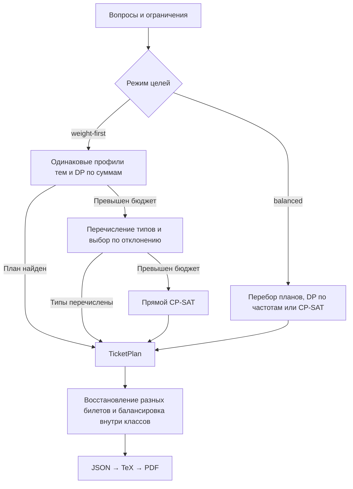

# Генератор билетов коллоквиума

Генератор составляет $B$ различных билетов по $R$ вопросов, учитывая тематические группы и желаемый суммарный вес. Вопросы внутри билета не повторяются; между билетами повторения разрешены. Перестановка вопросов не создаёт новый билет.

- [Алгоритмы, доказательства и асимптотики](ALGORITHM.md).

## Быстрый запуск

Команды выполняются из папки `colloq_tickets` в корне репозитория. Нужен Python 3.10+; для CP-SAT используется OR-Tools из `requirements.txt`.

```sh
python3 -m venv .venv
.venv/bin/python -m pip install -r requirements.txt
python3 main.py \
  --questions examples/questions_ma2.json \
  --questions-per-ticket 2 \
  --tickets 100 \
  --target-weight 6 \
  --group-mode different \
  --output tickets_ma2_100_grouped.json
```

В банке МА2 две темы: «Ряды» — 12 вопросов, «Мера» — 17. Эта команда создаёт 100 различных билетов с одним вопросом из каждого раздела. Всего таких пар $12\cdot17=204$, но подходящих по желаемой сложности может быть меньше.

`-n` — краткая запись `--questions-per-ticket`. Число вопросов может быть любым допустимым; отдельных алгоритмов для одного или двух вопросов нет.

`main.py` использует локальный `.venv`, если он существует, иначе текущий Python. На NixOS запуск также подключает libstdc++ и zlib из Nix store. Входные и выходные пути считаются относительно текущей рабочей папки.

Команды: `main.py generate` (или параметры генерации сразу), `main.py print`, `main.py test`. Справка: `python3 main.py --help` и `python3 main.py print --help`.

## Формат вопросов

Входной файл — JSON-массив в UTF-8, допускается BOM:

```json
[
  {"id": "r1", "text": "Признак Коши", "weight": 1, "group": "Ряды"},
  {"id": "r2", "text": "Теорема Римана", "weight": 4, "group": "Ряды"},
  {"id": "m1", "text": "Определение меры", "weight": 1, "group": "Мера"},
  {"id": "m2", "text": "Теорема Каратеодори", "weight": 4, "group": "Мера"}
]
```

| Поле | Требование |
|---|---|
| `id` | Уникальная непустая строка |
| `text` | Непустой текст вопроса |
| `weight` | Положительное конечное число; сложность вопроса |
| `group` | Непустая строка; при отсутствии используется `default` |

Названия групп сравниваются с учётом регистра. Дополнительные поля читаются без ошибки, но не сохраняются в модели и результате. В частности, `section` не заменяет `group`.

Число различных весов $D$ определяется по банку. Допустимы дробные веса, например `0.5`, `1.5`, `4`. После чтения JSON веса переводятся в `Fraction(str(weight))`: дальнейшие расчёты точные для полученных значений, без приближённого объединения близких весов. Сам JSON читается стандартным парсером Python, поэтому произвольная десятичная точность входных чисел не гарантируется. Итоговые суммы в JSON выводятся обычными числами Python и могут содержать погрешность `float`.

## Тематические ограничения

| `--group-mode` | Состав одного билета |
|---|---|
| `different` | Все вопросы из разных тем; максимум один из каждой |
| `same` | Все вопросы из одной темы |
| `ignore` | Темы не ограничивают состав; режим по умолчанию |

В `different` при $R=T$, где $T$ — число тем, каждый билет содержит ровно один вопрос из каждой темы. При $R<T$ алгоритм выбирает и набор тем. В `same` разные билеты могут относиться к разным темам: квот по темам нет.

Связи между отдельными вопросами заменены группами. Старое поле `related` отклоняется с ошибкой, флага `--relations` нет. Для миграции нужно явно задать `group` и выбрать один из новых режимов.

## Цели оптимизации

По умолчанию используется `--objective-mode weight-first`:

1. Минимальное максимальное абсолютное отклонение веса билета от `--target-weight`.
2. Минимальная сумма абсолютных отклонений весов всех билетов.

После выбора сложности вопросы балансируются внутри взаимозаменяемых классов. Разница частот внутри одного класса не превосходит 1. Глобальное равенство частот разных весов не требуется: редкий тяжёлый вопрос может встречаться редко или не попасть в выдачу.

**`optimal=true` в этом режиме доказывает два критерия сложности, а не глобальный оптимум частот.** В JSON это отмечено как `objective_count=2` и `frequency_guarantee="within-class"`.

Для воспроизведения прежней строгой задачи есть `--objective-mode balanced`: максимальное отклонение → сумма квадратов частот → суммарное отклонение. В этом режиме три строгих критерия. Режим `balanced` использует прежние решатели по типам и CP-SAT; DP по суммам не подменяет его критерий частот.

## Автовыбор алгоритма

`--algorithm auto` включён по умолчанию. Обычная команда генерации не требует выбирать метод вручную.



Новый метод `profile-sum-dp` считает количество допустимых билетов для каждой суммы сложности. Одинаковые гистограммы тем вычисляются один раз; кратности учитываются без объединения исходных тем. Для `different` при $R=T$ не строятся состояния с пропущенными темами. При восстановлении сохраняются исходные группы, число вопросов и уникальность наборов.

Если таблицы не укладываются в бюджет, `auto` переходит к перечислению типов. При двух строгих критериях достаточно брать типы в порядке отклонения, учитывая вместимости; имя метода — `weight-types`. Если и перечисление слишком велико, используется прямой CP-SAT. Причины переключений записываются в `optimization.diagnostics`.

Ручные методы оставлены для проверки и сравнения:

| `--algorithm` | Метод |
|---|---|
| `auto` | Выбор пути с учётом режима целей и бюджетов |
| `sum-dp` | Профили тем и DP по суммам; только `weight-first` |
| `enumerate` | Точный перебор количественных планов |
| `dp` | Точная DP по независимым частотам |
| `cp-sat-types` | CP-SAT с количеством билетов каждого типа |
| `cp-sat` | Прямая CP-SAT-модель по вопросам |

В `balanced` автовыбор использует однозначный план, небольшой перебор, DP по независимым частотам или CP-SAT. Перебор и DP также умеют выбирать дополнение к пулу. Специализаций по фиксированным значениям $R$ нет.

Профильная DP, перебор, DP по частотам и восстановление работают на стандартной библиотеке Python. OR-Tools загружается только при необходимости CP-SAT. `auto` выбирает по доступному представлению и бюджету; он не гарантирует минимальное время среди всех методов.

## Лимиты и гарантии

| Параметр | По умолчанию | Назначение |
|---|---|---|
| `--max-search-nodes` | `100000` | Лимит перечисления типов и отдельного перебора планов |
| `--max-dp-states` | `100000` | Для DP по суммам — все сохранённые состояния; для DP по частотам — состояния слоя. Бюджет переходов — в 10 раз больше; построение проекции частот также ограничено |
| `--time-limit` | `30` | Общий бюджет последовательных стадий решения CP-SAT, в секундах |
| `--allow-feasible` | Выключен | Разрешить найденный допустимый результат без доказательства всех критериев |

Это отдельные бюджеты, а не общий таймер программы. Подготовка данных, перечисление типов, DP, построение модели и восстановление не входят в `--time-limit`.

В `auto` превышение лимита DP по суммам ведёт к типам; превышение лимита перечисления типов — к прямому CP-SAT. В `balanced` превышение лимита перебора или DP по частотам ведёт к следующему подходящему методу. Принудительно выбранный метод при превышении лимита завершается ошибкой. `--allow-feasible` относится к CP-SAT и не разрешает выдавать частичный ответ перебора или DP.

По умолчанию результат записывается только после доказательства всех строгих критериев выбранного режима. Если оптимизация завершается ошибкой, существующий файл результата не перезаписывается. При успешном запуске файл `--output` перезаписывается; запись поверх входного банка запрещена.

## Выходной JSON

| Поле | Содержимое |
|---|---|
| `target_weight` | Заданный вес билета |
| `max_weight_deviation` | Максимальное отклонение полученных билетов |
| `question_usage` | Частота каждого вопроса, включая нулевые |
| `tickets` | Номера билетов, веса, отклонения и вопросы с `id`, `text`, `weight`, `group` |
| `optimization` | Метод, режим групп, статусы и размеры сжатой модели |

В `optimization`:

- `objective_mode` — `weight-first` или `balanced`;
- `objective_count` — число строгих критериев: 2 или 3;
- `objectives` — их имена в порядке оптимизации;
- `optimal` — доказан ли оптимум всех строгих критериев выбранного режима;
- `proven_objectives` — длина доказанного начального префикса критериев, от 0 до `objective_count`;
- `frequency_guarantee` — `within-class` для баланса внутри классов либо `global-optimum` при доказанном глобальном частотном критерии в `balanced`;
- `weight_classes` — число различных весов $D$;
- `question_classes` — число классов вопросов $C$;
- `ticket_types` — число типов после отбора по отклонению; `null` у прямого CP-SAT и DP по суммам;
- `diagnostics` — число исходных тем `topics`, используемых тем `effective_topics` (в `ignore` — одна), профилей `topic_profiles`, состояний и переходов DP по суммам, число выбранных типов после восстановления либо причины переключения метода.

`optimal=false` означает, что решение допустимо, но его оптимальность полностью не доказана. При равенстве критериев разные методы могут возвращать разные наборы билетов.

## Python API: выбор и восстановление отдельно

```python
from pathlib import Path
from src.table_io import read_questions
from src.planning import plan_tickets
from src.reconstruction import restore_tickets

questions = read_questions(Path("examples/questions_ma2.json"))
plan = plan_tickets(
    questions,
    questions_per_ticket=2,
    ticket_count=100,
    group_mode="different",
    target_weight=6,
)
result = restore_tickets(plan)
```

`plan_tickets()` возвращает `TicketPlan` со снимком банка и классами. У DP по суммам в `plan.selection.sum_plan` лежат количества билетов каждой суммы и таблицы для восстановления; конкретные вопросы ещё не выбраны. У остальных методов в `selection.types` и `selection.amounts` лежит план по типам. `restore_tickets()` подставляет вопросы и балансирует частоты внутри классов, сохраняя сложности и уникальность. Повторное восстановление одного плана воспроизводимо.

`src.generation.generate_tickets_report()` объединяет оба этапа и возвращает `GenerationResult`; `src.generation.generate_tickets()` возвращает только список билетов. Прямая модель CP-SAT тоже отдаёт план общему восстановителю.

## Печать и разрезание

```sh
python3 main.py print tickets_ma2_100_grouped.json
lualatex -interaction=nonstopmode -halt-on-error tickets_ma2_100_grouped.tex
```

Экспортёр работает без сторонних Python-пакетов. Для сборки PDF нужен LuaLaTeX или XeLaTeX, пакеты `fontspec`, `babel/russian`, `geometry` и шрифт Liberation Serif. По умолчанию: A4, четыре билета на странице, пунктирные линии разреза. Веса и служебная статистика не печатаются.

```sh
python3 main.py print tickets_ma2_100_grouped.json \
  --tickets-per-page 3 \
  --font "DejaVu Serif" \
  --title "Математический анализ"
```

При большом числе вопросов уменьшайте число билетов на странице и проверяйте вёрстку PDF. Входной `text` трактуется как обычный текст: произвольные TeX-команды не исполняются.

Параметры экспорта:

| Параметр | Назначение / по умолчанию |
|---|---|
| `-o` | Путь TeX; по умолчанию рядом с JSON с расширением `.tex` |
| `--tickets-per-page` | От 1 до 8 билетов на листе; по умолчанию 4 |
| `--margin-mm` | Поля, 12 мм |
| `--font-size` | Размер шрифта, 12 pt |
| `--font` | Шрифт с кириллицей, Liberation Serif |
| `--title` | Название курса |
| `--institution` | Название организации, ФКН ВШЭ |

На каждом билете печатаются организация, курс, номер и все вопросы. Спецсимволы TeX экранируются, символы σ, δ, β и верхний индекс ⁿ переводятся в математические команды. pdfLaTeX для этого шаблона не подходит. При неполной последней странице оставшаяся часть листа остаётся пустой.

Автоматического уменьшения шрифта для длинного текста нет. Сообщения `Overfull vbox/hbox` в журнале сборки означают, что нужно увеличить доступное место: например, уменьшить число билетов на странице. Печатайте A4 в масштабе 100%, односторонне; разрезайте по пунктирным линиям.

Результаты генерации и печати не хранятся в Git. Генерация нового JSON сама по себе не обновляет его печатную версию: экспортируйте TeX и соберите PDF заново.

## Структура и проверки

```text
colloq_tickets/
├── examples/          # Демонстрационный банк и банк МА2
├── src/               # Реализация и CLI
├── tests/             # Проверки алгоритмов и печати
├── main.py            # Единая точка входа
├── requirements.txt   # OR-Tools для CP-SAT
├── README.md
└── ALGORITHM.md
```

В `src/` отдельно расположены выбор плана (`planning.py`), профильная DP (`sum_dp.py`, `sum_selection.py`), восстановление (`sum_reconstruction.py`, `reconstruction.py`) и остальные решатели. Общие цели определены в `objectives.py`; экспорт TeX — в `print_tickets.py`.

```sh
python3 main.py test
```

Тесты сравнивают результаты с полным перебором на малых банках, проверяют группы, дробные веса, уникальность, восстановление, статусы решателя и экспорт TeX.

Проверки включают оба режима целей и все ручные решатели. Для малых банков считаются все допустимые билеты, проверяются их количества по суммам и восстановление всех комбинаторных индексов, в том числе для повторяющихся профилей. Отдельно проверяются превышение бюджетов, переходы `auto`, большие вместимости, произвольный размер билета и статусы частично доказанного CP-SAT.

Реальные локальные данные можно хранить в `.test/` или `local/`: эти каталоги исключены из Git.
