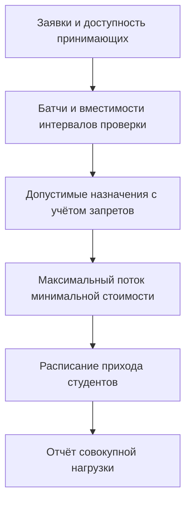

# Алгоритм распределения студентов

Реализация — [src/allocation.py](src/allocation.py). Форматы таблиц и команды запуска — в [README.md](README.md).

Настройки длительностей CLI находятся в [config.json](config.json). Единицы времени и ранги предпочтений именованы в `src/data.py`: `MINUTES_PER_HOUR`, `OUTSIDE_PREFERENCE_PENALTY`, `UNASSIGNED_PENALTY`, `PRIORITY_RADIX`. Основание кодирования выводится из худшего ранга, чтобы изменение констант не рассогласовало формулу стоимости.

## Обозначения

| Обозначение | Смысл |
|---|---|
| $N$ | Число студентов |
| $B$ | Число батчей прихода |
| $P$ | Продолжительность подготовки, минуты |
| $R$ | Продолжительность проверки, минуты |
| $c_b$ | Вместимость батча $b$ |
| $F$ | Число распределённых студентов |

## Батчи и допустимые назначения

Для каждого времени прихода $t_b$ проверка занимает полуинтервал:

$$
[t_b+P,\ t_b+P+R).
$$

Вместимость $c_b$ равна числу принимающих, доступных на всём этом интервале. Доступность в соседние часы учитывается непрерывно. Самый ранний приход — не раньше начала доступности принимающих.

Студенту доступен батч, только если запрещённые часы не пересекают весь период его присутствия:

$$
[t_b,\ t_b+P+R).
$$

Пожелания относятся к часу прихода. Их повторения сворачиваются к лучшему приоритету. Для опоздавших заявок пожелания игнорируются, но запреты сохраняются.

## Граф потока

Сеть состоит из источника, вершин студентов, вершин батчей и стока:

- источник → студент: вместимость 1;
- студент → допустимый батч: вместимость 1, стоимость назначения;
- батч → сток: вместимость $c_b$.

Единица потока соответствует назначению студента в батч. Целочисленные вместимости обеспечивают целочисленные назначения.

Конкретные принимающие не назначаются. Каждый батч имеет достаточное число принимающих, доступных на всю проверку; последовательные проверки для используемого шага батчей не перекрываются.

## Порядок целей

1. Максимизировать число назначенных студентов.
2. Среди них максимизировать число своевременно подавших заявки.
3. Минимизировать суммарный штраф пожеланий: первый приоритет — 0, второй — 1, третий — 2, другое допустимое время — 3. Для опоздавших штраф всегда 3.
4. При равенстве предыдущих критериев улучшать назначение самой ранней заявки, затем следующей. Нераспределение хуже допустимого назначения; при равном приоритете предпочтителен более ранний приход.

Дедлайн включительный. При равном времени заявки порядок определяется исходной строкой; без времени заявки используется порядок строк.

Критерии стоимости кодируются большими целыми с разрядами, которые исключают влияние менее важной цели на более важную. Максимальный размер потока определяется отдельно от стоимости. Поэтому преимущество ранней заявки не может уменьшить число назначений или ухудшить глобальные старшие критерии.

## Поиск потока

Используется последовательное увеличение потока по кратчайшему пути в остаточной сети. Начальные потенциалы вычисляются проходом по ациклическому исходному графу; затем применяется Дейкстра с потенциалами. Обратные рёбра позволяют менять предыдущие назначения, когда это улучшает глобальное решение.

## Асимптотика

Число вершин и рёбер:

$$
V=N+B+2,\qquad E=O(NB+N+B).
$$

Поиск потока выполняет не более $F\le N$ увеличений:

$$
O\bigl(V+E+F(V+E)\log V\bigr)
$$

арифметических операций и использует $O(V+E)$ памяти графа. Это оценка именно поиска потока: чтение таблиц, вычисление доступности батчей и запись результата учитываются отдельно.

Стоимости могут занимать $O(N\log(B+1))$ бит, поэтому операции с ними не имеют постоянной битовой стоимости. Отчёт нагрузки строится по границам интервалов проверки и доступности; он оценивает совокупный спрос и не изменяет расписание.

## Проверки

Тесты проверяют вместимости, запрещённые часы на всём периоде присутствия, подготовку, пересечение часовых границ, порядок заявок, дедлайн и перераспределение. Малые случайные задачи сравниваются с полным перебором.
